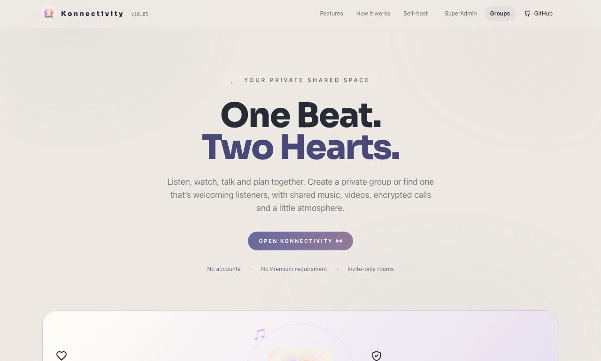
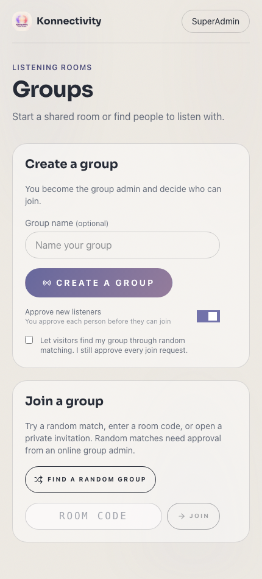
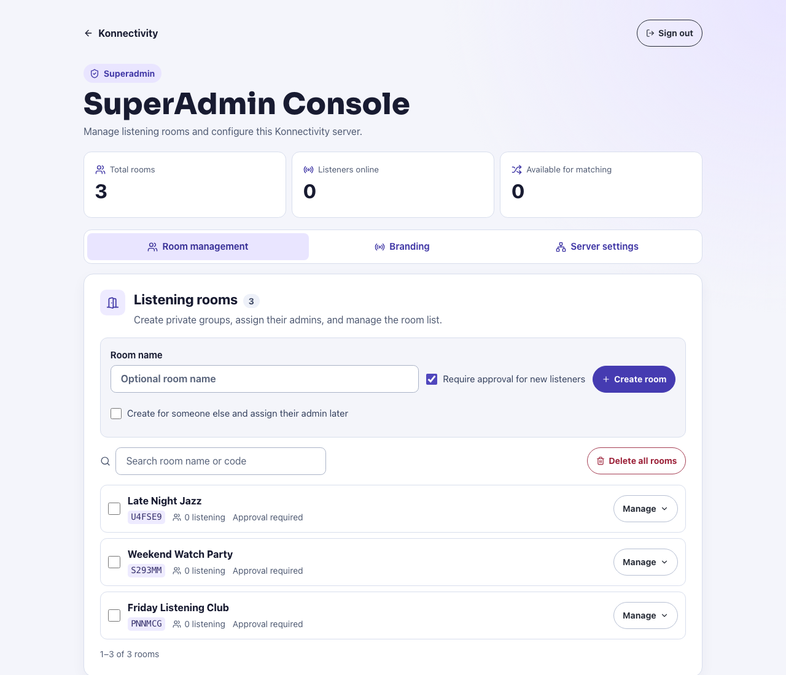
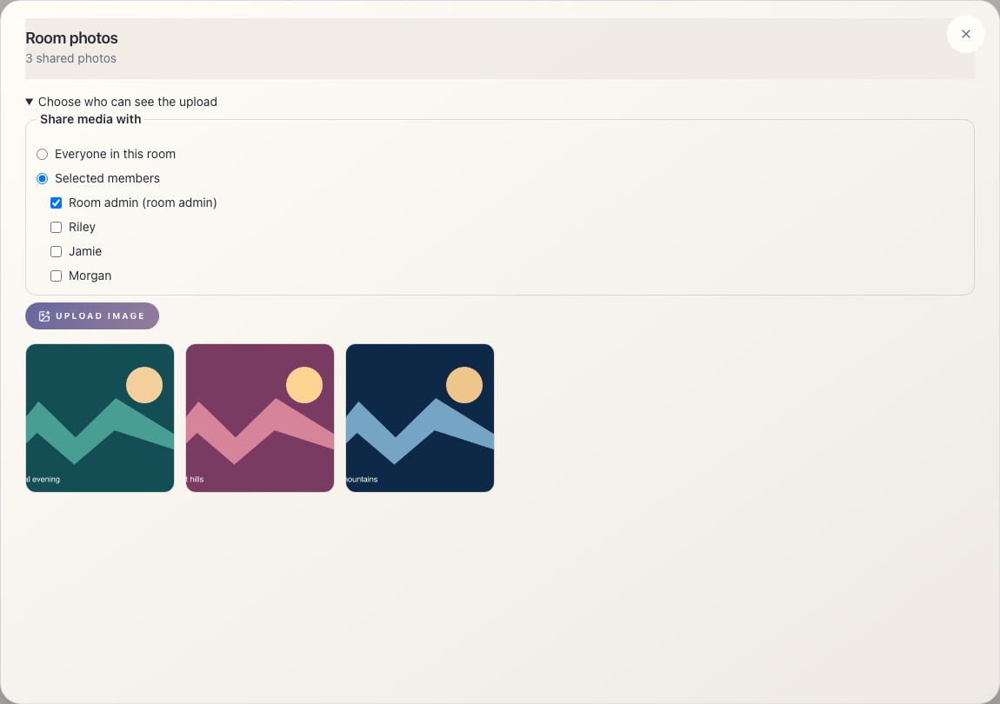

# Konnectivity · 10.05


**One Beat. Two Hearts**

Start a group, share one invitation, and listen together with synchronized playback, a shared queue, and live chat. Konnectivity also supports shared video, room calls, playlists, and custom room appearance. It runs on a computer you control.

**New in 10.05.** SuperAdmin sessions now expire after eight hours and are revoked on sign-out. Room reconnection, media uploads, browser security headers, and TURN credential renewal have been hardened. The release includes the Groups page, room photo albums, and optional private photo and video sharing from 10.04.

> **License:** This is a modified distribution of [Syncwave](https://github.com/SAKMZ/syncwave), under **PolyForm Noncommercial 1.0.0**. It is source-available, not OSI open source. The inherited noncommercial restriction cannot be removed by renaming the project. See [LICENSE](LICENSE), [NOTICE](NOTICE) and [release guidance](docs/RELEASING.md).

## Stable and development branches

| Branch | Purpose | Who should use it |
| --- | --- | --- |
| [`10.05`](https://github.com/shivam-aggarwal-git/Konnectivity/tree/10.05) | Stable branch, based on the verified installer and source-validation checks. Receives reviewed fixes. | Personal installations and deployments. |
| [`main`](https://github.com/shivam-aggarwal-git/Konnectivity/tree/main) | Development branch for new features and improvements. | Contributors and people testing upcoming changes. |

The previous [10.04](https://github.com/shivam-aggarwal-git/Konnectivity/tree/10.04) and [10.01](https://github.com/shivam-aggarwal-git/Konnectivity/tree/10.01) and [10.03](https://github.com/shivam-aggarwal-git/Konnectivity/tree/10.03) branches remain available. **This checkout is `10.05`.** Download links and guided installers below install this stable branch. Previous stable `10.02` remains available. A branch can receive fixes; use a commit SHA when you need an exact, reproducible version.

```sh
git clone --branch 10.05 --single-branch https://github.com/shivam-aggarwal-git/Konnectivity.git
cd Konnectivity
bash start.sh --local
```

To update an existing stable checkout, stop the app, back up your private `data/` directory, then run `git fetch origin`, `git switch 10.05`, `git pull --ff-only origin 10.05`, and start it again. Keep runtime data and credentials out of Git.

## Contribute

Contributions normally target `main`; stable fixes target `10.05` only when agreed with the maintainer. See [CONTRIBUTING.md](CONTRIBUTING.md) for fork/clone and sync commands, branch naming, tests, pull requests and the review/merge process. Follow [SECURITY.md](SECURITY.md) for private vulnerability reports.

## Credits and thanks to Syncwave

**Konnectivity builds on [Syncwave](https://github.com/SAKMZ/syncwave). A heartfelt thank-you to the Syncwave team, its original creators, maintainers and every contributor for building and sharing the project that made this fork possible.**

The original Syncwave codebase, interface and self-hosted listening-room architecture form the foundation of Konnectivity. Credit for that original work belongs to the Syncwave team and contributors. Konnectivity extends their work with the changes described in [CHANGELOG.md](CHANGELOG.md) and [NOTICE](NOTICE).

Please visit the [original Syncwave repository](https://github.com/SAKMZ/syncwave), explore their work and give the team your support. You can also see the [upstream contributors](https://github.com/SAKMZ/syncwave/graphs/contributors).

The upstream copyright notice and **PolyForm Noncommercial 1.0.0** license are preserved in [LICENSE](LICENSE) and [NOTICE](NOTICE). This fork is maintained separately; no affiliation with or endorsement by the Syncwave team is implied.


## Features

| Feature | What you can do |
| --- | --- |
| Private groups and random matching | Create a persistent group, share an invitation, or request to join a discoverable group. An online group admin approves random visitors. |
| Synchronized playback | Play, pause, seek, adjust shared volume, and reorder the queue. Each device corrects playback drift automatically. |
| YouTube audio and video | Search YouTube or paste a supported link. Audio is the default. Switch to video when you want to watch together. |
| Local library and playlists | Upload supported audio and video, import YouTube playlists, rearrange saved tracks, and queue several playlists in order. |
| Room photo albums | Upload images, browse shared photos with swipes or arrows, and share images or chat videos with selected members when the room admin allows it. |
| Calls and collaboration | Use encrypted room calls, screen sharing, chat with images, reactions, plans, and polls. |
| Shared appearance | Choose themes, room lights, and visualizers. Use photos or GIFs as a background, or hide artwork to see more of the scene. |
| Mobile and PWA | Use responsive playback controls and install the web app from a compatible browser. |
| Group administration | Approve and remove listeners, manage room permissions, and upload a separate YouTube cookie file for the group. |
| SuperAdmin Console | Manage rooms, delete selected rooms, upload a logo or favicon, and configure Proxy Pool and TURN. |
| Self-hosting | Use the desktop launcher on macOS or Windows, run the installer from a terminal, or deploy with Docker. |

## One-click start

[**Download Konnectivity ZIP**](https://github.com/shivam-aggarwal-git/Konnectivity/archive/refs/heads/10.05.zip)

Extract the ZIP, then open the launcher for your computer. It installs the required packages and media tools, builds the app, and opens localhost automatically. No personal playlists, songs, images, cookies or settings are included.

| Computer | Start here |
| --- | --- |
| macOS | Double-click `Start-Konnectivity.command`. |
| Windows | Double-click `Start-Konnectivity.bat`. |
| Linux | Open a terminal in the extracted folder and run `bash start.sh --local`. |

Prefer one command, without downloading/extracting manually?

**macOS / Linux:**

```sh
curl -fsSL https://raw.githubusercontent.com/shivam-aggarwal-git/Konnectivity/10.05/install.sh | bash
```

**Windows PowerShell:**

```powershell
& ([scriptblock]::Create((Invoke-RestMethod https://raw.githubusercontent.com/shivam-aggarwal-git/Konnectivity/10.05/install.ps1)))
```

These commands install into your user folder’s `Konnectivity` directory and start locally. Re-running starts the existing installation without replacing its data. Node.js 22, npm dependencies, ffmpeg, Deno and a runnable downloader are set up automatically on supported desktop platforms. The standalone downloader avoids requiring a separate Python installation. Internet access is needed on first run; keep the terminal open while listening.

Open **http://localhost:3000/setup**, set an admin password, then create a room. `--local` avoids a public tunnel. It binds to loopback by default. For LAN access set `BIND_HOST=0.0.0.0` and restrict access with your firewall.

Already using port 3000? On macOS/Linux:

```sh
PORT=3001 npm run launch -- --local
```

For a public invitation, finish local admin setup, stop the local launcher, then run:

```sh
npm run launch
```

The launcher starts an HTTPS Cloudflare quick tunnel after setup. Visitors can create groups from **Groups** after setup. Invite-only groups require a complete invitation. Opted-in groups also accept random join requests while a group admin is online. Its address changes on restart. Use the room’s **Share** button for the current invitation. Keep the host running while listening.

## Development and checks

```sh
npm run dev                 # custom Next.js + Socket.IO development server
npm run typecheck
npm test                    # deterministic client clock/drift tests
npm run test:integration    # isolated shared controls, upload, playlist, media and sync tests
npm run build
npm start                   # production, after a build; no public tunnel
npm run check:release       # checks source tree for private/runtime content
```

Use the custom server commands above rather than `next start`: realtime rooms and upload/audio routes need `server.mjs`. Integration tests create temporary fixtures, require ffmpeg and bind loopback sockets; they do not use your personal library.

## Docker

```sh
cp .env.example .env
# Edit PUBLIC_URL and optional settings for your deployment.
docker compose up -d --build
docker compose logs -f
docker compose down
```

Complete `/setup` locally before exposing the server. Docker does not create a public tunnel. `data/` and `cache/` are persistent bind mounts. Never commit them.

## Screenshots

| Product showcase | Groups on mobile |
| --- | --- |
|  |  |





See the [screenshot gallery](docs/SCREENSHOTS.md) for playback, video calls, and YouTube cookie setup.

## Documentation

- [Setup and commands](docs/SETUP.md)
- [Using rooms, uploads, playlists and chat](docs/USER_GUIDE.md)
- [Groups, cookies, SuperAdmin and room recovery](docs/ROOM_ADMINISTRATION.md)
- [Configuration](docs/CONFIGURATION.md)
- [Architecture and synchronization](docs/ARCHITECTURE.md)
- [Deployment, backup and upgrades](DEPLOY.md)
- [Troubleshooting](docs/TROUBLESHOOTING.md)
- [Security and deployment notes for 10.05](docs/SECURITY_10.05.md)
- [Release and licensing checklist](docs/RELEASING.md)
- [Contributing](CONTRIBUTING.md) · [Security](SECURITY.md) · [Code of conduct](CODE_OF_CONDUCT.md)

YouTube embeds use each listener’s own browser session. A server-side cookie does not transfer Premium to friends. Autoplay, ads, embedding restrictions and unreported headphone delay can limit synchronization. Use only content you have permission to upload or access.


## Legal

Konnectivity is a self-host tool. You run it and are responsible for how it is used where you live, including compliance with applicable laws, copyright permissions and the terms of any services you access.

Streaming audio from YouTube with unofficial tools may violate [YouTube’s Terms of Service](https://www.youtube.com/static?template=terms). Do not run a public or for-profit streaming service on top of it. A private invitation link is intended for listening with friends, not operating a public streaming platform. Only upload or access content you have permission to use and share.

Konnectivity and its upstream project, Syncwave, are not affiliated with, endorsed by or sponsored by Spotify or YouTube. Product names and trademarks belong to their respective owners.

Konnectivity retains Syncwave’s **PolyForm Noncommercial 1.0.0** license and required copyright notice. See [LICENSE](LICENSE) for the full terms and warranty disclaimer, and [NOTICE](NOTICE) for upstream attribution. The software license does not grant rights to third-party music or videos.

## Rooms, privacy and playback

Groups are private by default. The creator becomes the group admin. Group data stays on the server across restarts. Keep the private admin recovery link somewhere safe if you use a rotating tunnel address. New groups require their own YouTube cookie upload for YouTube playback and link imports. Group cookies are managed by the group admin. The server operator configures TURN and Proxy Pool in the SuperAdmin Console.

[Room roles and setup](docs/ROOM_ADMINISTRATION.md) · [Calls and collaboration](docs/ROOM_SOCIAL.md) · [FAQ](docs/FAQ.md)
