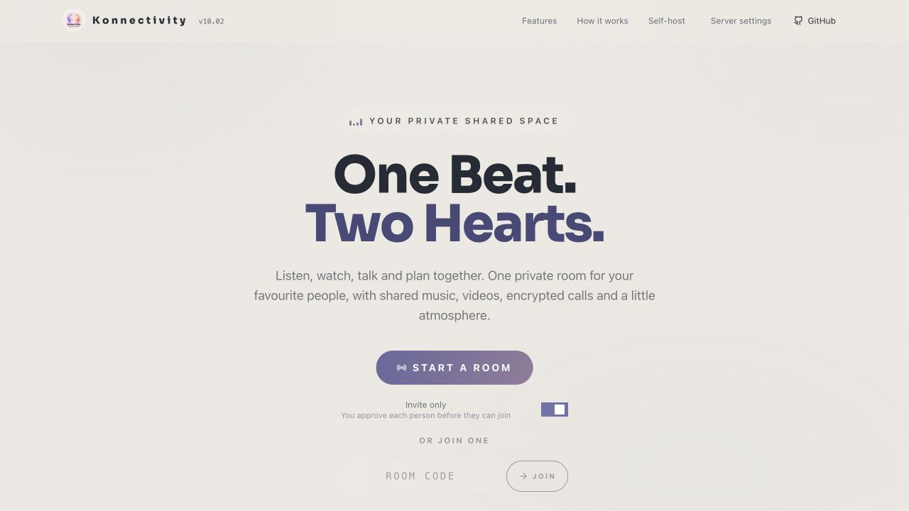
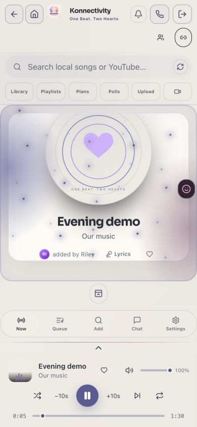
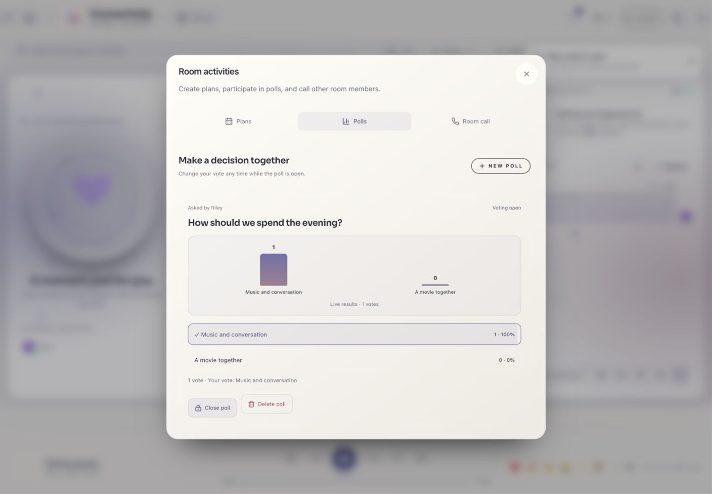

# Konnectivity · 10.03


**One Beat. Two Hearts**

Create a private room for shared music, YouTube and uploaded MP4 videos, encrypted room calls, chat, plans and polls. Pearl is the default theme; either participant can preview and save a shared appearance. The host manages admission and cannot be removed by guests. When the host leaves, the room and its invitation expire.

### Stable 10.03 changes

- Immediate progressive playback: slow or blocked listeners never pause anyone else.
- Natural camera orientation, front/rear camera switching, and a timed active-call banner with hangup.
- Home and browser Back minimize an active call; explicit Leave party still ends the host’s room.

- Direct Audio / Video calling with ringing while the browser requests device permission; no separate preview step.
- Host hangup or detected host disconnect ends the room call for all participants.
- Shared microphone, camera and screen-sharing status with visible mute labels.
- Remote track mute/unmute refresh and queued early signaling for mobile call receivers.
- Atomic shared replay with a new playback epoch; stale end events cannot skip the replay.
- Host listener permissions, protected platform settings, cookie import, Cloudflare diagnostics and a reported 750 GB cutoff.
- Independent upload buffering, silent-video detection, mobile video sizing, floating player and device-enable actions.
- Personal configuration, credentials, uploads, media and runtime/container state are excluded. Docker definitions and empty configuration templates are included.

Stable release 10.03. Actual device behavior still depends on browser permissions, codec support and network conditions.

### Current interface

- **Appearance:** private previews for themes, backgrounds, visualizers and room lights. X, Save and Cancel remain visible while the content scrolls. Successful Save and Submit actions close their menus.
- **Activities:** Plans and Polls open directly from the toolbar. The notification bell records new plans, polls, responses and votes, with an in-app popup for live activity.
- **Song comments:** room members can leave comments on the current song, separate from general chat. Comments are room-scoped and are cleared when the room ends.
- **Search:** use the Refresh button beside “Suggestions for your next moment” for a different set of suggestions, without reloading the page. Library, Upload, People and Share remain directly accessible.
- **Media:** uploaded MP3/FLAC/WAV audio and MP4/MOV/MKV/WebM video, up to 100 MB per file. Videos are converted to browser-friendly H.264/AAC MP4. Every new selection starts in Audio mode; switch to Video explicitly. Replay, fullscreen and show/hide controls are available in Video mode.
- **Calls:** WebRTC media encryption, room membership checks and optional Cloudflare TURN. Casting requires a compatible browser and receiver.


> **License:** This is a modified distribution of [Syncwave](https://github.com/SAKMZ/syncwave), under **PolyForm Noncommercial 1.0.0**. It is source-available, not OSI open source. The inherited noncommercial restriction cannot be removed by renaming the project. See [LICENSE](LICENSE), [NOTICE](NOTICE) and [release guidance](docs/RELEASING.md).

## Stable and development branches

| Branch | Purpose | Who should use it |
| --- | --- | --- |
| [`10.03`](https://github.com/shivam-aggarwal-git/Konnectivity/tree/10.03) | Stable branch, based on the verified installer and source-validation checks. Receives reviewed fixes. | Personal installations and deployments. |
| [`main`](https://github.com/shivam-aggarwal-git/Konnectivity/tree/main) | Development branch for new features and improvements. | Contributors and people testing upcoming changes. |

The previous `10.01` branch is retained for older installations. **This checkout is `10.03`.** Download links and guided installers below install this stable branch. Previous stable `10.02` remains available. A branch can receive fixes; use a commit SHA when you need an exact, reproducible version.

```sh
git clone --branch 10.03 --single-branch https://github.com/shivam-aggarwal-git/Konnectivity.git
cd Konnectivity
bash start.sh --local
```

To update an existing stable checkout, stop the app, back up your private `data/` directory, then run `git switch 10.03`, `git pull --ff-only origin 10.03`, and start it again. Keep runtime data and credentials out of Git.

## Contribute

Contributions normally target `main`; stable fixes target `10.03` only when agreed with the maintainer. See [CONTRIBUTING.md](CONTRIBUTING.md) for fork/clone and sync commands, branch naming, tests, pull requests and the review/merge process. Follow [SECURITY.md](SECURITY.md) for private vulnerability reports.

## Credits and thanks to Syncwave

**Konnectivity builds on [Syncwave](https://github.com/SAKMZ/syncwave). A heartfelt thank-you to the Syncwave team, its original creators, maintainers and every contributor for building and sharing the project that made this fork possible.**

The original Syncwave codebase, interface and self-hosted listening-room architecture form the foundation of Konnectivity. Credit for that original work belongs to the Syncwave team and contributors. Konnectivity extends their work with the changes described in [CHANGELOG.md](CHANGELOG.md) and [NOTICE](NOTICE).

Please visit the [original Syncwave repository](https://github.com/SAKMZ/syncwave), explore their work and give the team your support. You can also see the [upstream contributors](https://github.com/SAKMZ/syncwave/graphs/contributors).

The upstream copyright notice and **PolyForm Noncommercial 1.0.0** license are preserved in [LICENSE](LICENSE) and [NOTICE](NOTICE). This fork is maintained separately; no affiliation with or endorsement by the Syncwave team is implied.



## Features

| Feature | What you can do |
| --- | --- |
| Listening rooms | Start a room and invite friends with one link to your self-hosted server. |
| Shared queue | Anyone in the room can add songs, reorder the queue and vote on tracks. |
| Synchronized controls | Play, pause, drag the song timeline, seek ±10 seconds and change shared volume. |
| Automatic synchronization | Calibrate each device’s clock, correct drift, buffer independently without holding other listeners and recover after reconnecting. |
| Play now | Start a selected song immediately instead of adding it to the end of the queue. |
| YouTube search and video | Search for music and automatically open the selected YouTube video when playing an online result. |
| Link imports | Add supported YouTube and Spotify links; Spotify imports resolve to matching YouTube tracks. |
| Local music library | Upload MP3, FLAC, WAV and other supported formats to your server, with duplicate detection and persistent storage. |
| Saved playlists | Create and arrange playlists; opt in to saving references across new room codes and tunnel links. |
| Text and image chat | Chat while listening and share JPEG, PNG, GIF or WebP images. |
| Reactions and presence | React to songs and see who is listening in the room. |
| Optional AI DJ | Request music in plain English using your configured AI provider; disabled by default. |
| Themes and atmosphere | Moonlight, Rosewood and Candlelight themes, locally hosted Lottie artwork, optional ambient visualizers and reduced-motion support. |
| Mobile and PWA | Use a responsive interface with mobile volume controls, persistent search with All / Local library / YouTube filters and a clear button, and an installable web app. |
| Personal space | Opt in to reusing appearance, settings and photo/GIF backgrounds throughout this server. |
| One-click setup | Download/extract and start, or use the guided installer; runtime dependencies are set up automatically on supported platforms. |
| Server administration | Manage password-protected settings, optional downloader cookies and proxy configuration. |

Synchronization is automatic, but network outages, browser autoplay rules, YouTube ads and unreported headphone delay can affect how closely devices stay aligned.

No songs, cookies, API keys, passwords, existing rooms or user chat are included. You supply your own content and any optional credentials.

## One-click start

[**Download Konnectivity ZIP**](https://github.com/shivam-aggarwal-git/Konnectivity/archive/refs/heads/10.03.zip)

Extract the ZIP, then open the launcher for your computer. It installs the required packages and media tools, builds the app, and opens localhost automatically. No personal playlists, songs, images, cookies or settings are included.

| Computer | Start here |
| --- | --- |
| macOS | Double-click `Start-Konnectivity.command`. |
| Windows | Double-click `Start-Konnectivity.bat`. |
| Linux | Open a terminal in the extracted folder and run `bash start.sh --local`. |

Prefer one command, without downloading/extracting manually?

**macOS / Linux:**

```sh
curl -fsSL https://raw.githubusercontent.com/shivam-aggarwal-git/Konnectivity/10.03/install.sh | bash
```

**Windows PowerShell:**

```powershell
& ([scriptblock]::Create((Invoke-RestMethod https://raw.githubusercontent.com/shivam-aggarwal-git/Konnectivity/10.03/install.ps1)))
```

These commands install into your user folder’s `Konnectivity` directory and start locally. Re-running starts the existing installation without replacing its data. Node.js 22, npm dependencies, ffmpeg, Deno and a runnable downloader are set up automatically on supported desktop platforms. The standalone downloader avoids requiring a separate Python installation. Internet access is needed on first run; keep the terminal open while listening.

Open **http://localhost:3000/setup**, set an admin password, then create a room. `--local` avoids a public tunnel. It binds to loopback by default. For LAN access set `BIND_HOST=0.0.0.0` and restrict access with your firewall.

Already using port 3000? On macOS/Linux:

```sh
PORT=3001 npm run launch -- --local
```

For a public invitation, finish local admin setup, stop the local launcher, then run:

```sh
npm run launch
```

The launcher starts an HTTPS Cloudflare quick tunnel after setup. Guests need a complete invitation from **Share**, including its private token. Only the signed-in host can create rooms. Its address changes on restart. Use the room’s **Share** button for the current invitation. Keep the host running while listening.

## Development and checks

```sh
npm run dev                 # custom Next.js + Socket.IO development server
npm run typecheck
npm test                    # deterministic client clock/drift tests
npm run test:integration    # isolated shared controls, upload, playlist, media and sync tests
npm run build
npm start                   # production, after a build; no public tunnel
npm run check:release       # checks source tree for private/runtime content
```

Use the custom server commands above rather than `next start`: realtime rooms and upload/audio routes need `server.mjs`. Integration tests create temporary fixtures, require ffmpeg and bind loopback sockets; they do not use your personal library.

## Docker

```sh
cp .env.example .env
# Edit PUBLIC_URL and optional settings for your deployment.
docker compose up -d --build
docker compose logs -f
docker compose down
```

Complete `/setup` locally before exposing the server. Docker does not create a public tunnel. `data/` and `cache/` are persistent bind mounts. Never commit them.

## Screenshots · interface overview

These screenshots use a separate demo instance, fictional participants and generated media. They contain no private photos, credentials, TURN settings or public invitation URLs.

| Pearl desktop | Mobile audio player |
| --- | --- |
|  |  |




## Documentation

- [Setup and commands](docs/SETUP.md)
- [Using rooms, uploads, playlists and chat](docs/USER_GUIDE.md)
- [Configuration](docs/CONFIGURATION.md)
- [Architecture and synchronization](docs/ARCHITECTURE.md)
- [Deployment, backup and upgrades](DEPLOY.md)
- [Troubleshooting](docs/TROUBLESHOOTING.md)
- [Release and licensing checklist](docs/RELEASING.md)
- [Contributing](CONTRIBUTING.md) · [Security](SECURITY.md) · [Code of conduct](CODE_OF_CONDUCT.md)

YouTube embeds use each listener’s own browser session. A server-side cookie does not transfer Premium to friends. Autoplay, ads, embedding restrictions and unreported headphone delay can limit synchronization. Use only content you have permission to upload or access.


## Legal

Konnectivity is a self-host tool. You run it and are responsible for how it is used where you live, including compliance with applicable laws, copyright permissions and the terms of any services you access.

Streaming audio from YouTube with unofficial tools may violate [YouTube’s Terms of Service](https://www.youtube.com/static?template=terms). Do not run a public or for-profit streaming service on top of it. A private invitation link is intended for listening with friends, not operating a public streaming platform. Only upload or access content you have permission to use and share.

Konnectivity and its upstream project, Syncwave, are not affiliated with, endorsed by or sponsored by Spotify or YouTube. Product names and trademarks belong to their respective owners.

Konnectivity retains Syncwave’s **PolyForm Noncommercial 1.0.0** license and required copyright notice. See [LICENSE](LICENSE) for the full terms and warranty disclaimer, and [NOTICE](NOTICE) for upstream attribution. The software license does not grant rights to third-party music or videos.

## Rooms, privacy and playback

- The host approves admission when invite-only is enabled. Guests can control shared playback and appearance, create plans/polls, vote and comment; guests cannot remove the host.
- Host departure ends the room for everyone, clears room chat, polls, plans and comments, and invalidates its invitation. A new room has a new code/token. The server's base hostname can stay the same.
- The server retains uploaded media privately in its local library. Matching normalized names and renamed byte-identical files reuse existing media rather than writing another file. Files are not overwritten on name collisions.
- Every new selection starts in Audio mode. Use the camera icon to explicitly switch to Video. Uploads accept common audio formats and MP4/MOV/MKV/WebM, up to 100 MB per file, and convert video to H.264/AAC MP4.
- Replay uses the circular-arrow icon; fullscreen fills the browser viewport; the eye icon hides/shows controls without stopping playback. A finished video can be replayed.
- Both audio/crossfade slots stop and clear their sources when the room has no current media, prepares a different track or disconnects. Cached audio is prepared before shared playback, and uploaded media streams immediately through native HTTP Range playback.
- Search suggestions have their own Refresh action. It cycles recommendation seeds without reloading the page or changing the room. Results still depend on search-provider availability.
- Saved appearance, plans, polls and comments are synchronized. Device permissions, notification muting, casting and local control visibility remain per-device.
- WebRTC calls use encrypted browser-to-browser media. Optional TURN relays carry encrypted traffic; reliable calls on restricted networks require a reachable relay. Configure your own service privately; no working TURN configuration or credentials ship in this repository.
- Cloudflare TURN supports a 750 decimal GB monthly cutoff based on provider-reported account egress. Reporting can lag; this is not an instantaneous billing hard cap. The guard fails closed if required analytics are unavailable.
- Casting is offered only where the browser exposes a compatible remote-playback API and requires a compatible receiver.
- Local notification recordings are optional; this code-only release includes generated fallback tones, not personal recordings.

### Room calls in 10.03

The image below uses synthetic test devices, not personal cameras or photos.


