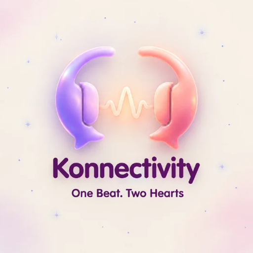
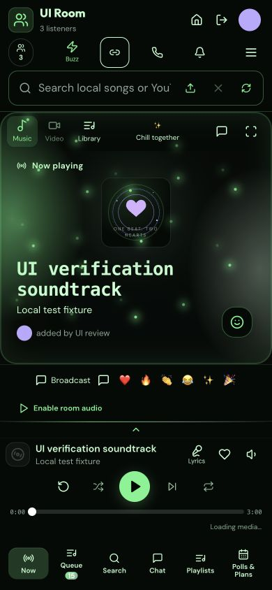
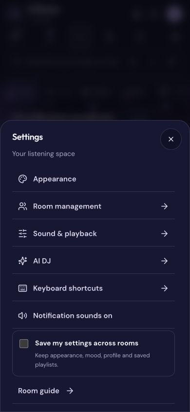
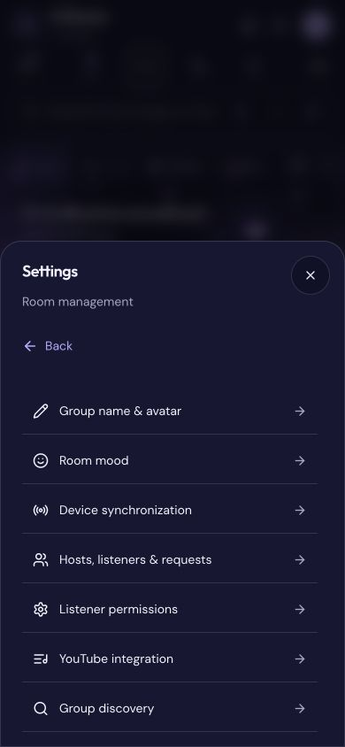
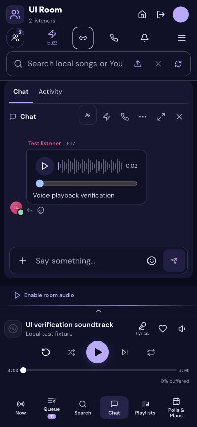
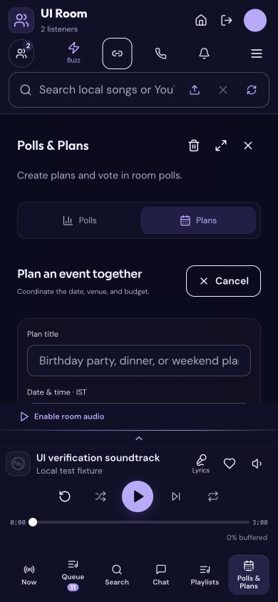
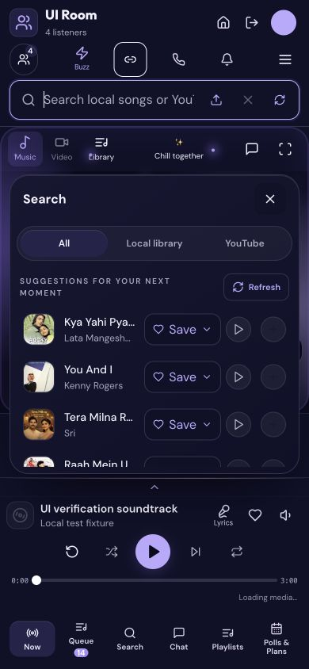
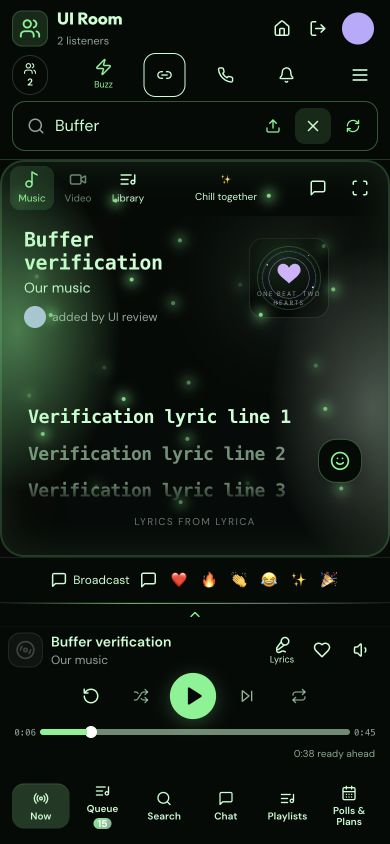
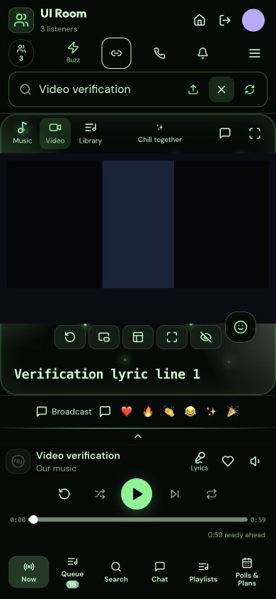

# Konnectivity — Self-Hosted Music Listening Rooms

**Listen together with synchronized playback, shared playlists, video and live chat.**

Konnectivity runs on a computer or server you control. Create a listening room, share its invitation, and enjoy a shared queue with friends on mobile or desktop. Version **10.06** brings a mobile-first interface, organized Settings, inline lyrics and song comments, co-host controls, and clearer playlist navigation.

**One Beat. Two Hearts.**

[Download 10.06](https://github.com/shivam-aggarwal-git/Konnectivity/archive/refs/heads/10.06.zip) · [Setup guide](docs/SETUP.md) · [User guide](docs/USER_GUIDE.md) · [Mobile screenshots](docs/SCREENSHOTS.md) · [Release notes](docs/RELEASE_10.06.md)



## Mobile screenshots

Current Konnectivity 10.06 screens captured at 390 × 844 in an isolated demonstration room with fictional content.

| Shared music player | Settings and appearance |
| --- | --- |
|  |  |

| Room management and co-hosts | Live chat and voice notes |
| --- | --- |
|  |  |

### Polls, plans and location sharing



[View screenshot details](docs/SCREENSHOTS.md).

## What is new in 10.06?

- **Mobile-first navigation:** persistent player controls, direct Playlists access, Home and Leave Party actions, and a clear distinction between group and personal avatars.
- **One Settings hierarchy:** Appearance, Room management, Sound & playback, AI DJ and keyboard shortcuts, with Back navigation. Personal details stay under the profile avatar.
- **Inline lyrics and comments:** timed lyrics highlight and scroll with playback when the provider supplies timestamps. Song comments have their own scroll area and typed `@` listener suggestions.
- **A clearer playlist flow:** successful creation/import keeps the playlist visible and shows confirmation. A single-video URL imports one video; a playlist URL needs its `list=` identifier to import individual entries.
- **Shared room controls:** multiple hosts, visible listener counts, mood editing, permissions, group naming and avatars. New group names are limited to 15 characters.
- **Chat and social features:** GIF search, emoji and basic emoticons, voice-note playback, media recipients, Buzz, calls, polls and plans. Drafts survive panel navigation; individual poll options can be removed.
- **Opt-in saved preferences:** reuse appearance, mood, profile, group avatar, saved playlists and library references across rooms on the same server/device identity. Chats and access credentials are not copied.

## Features

| Feature | How it helps |
| --- | --- |
| Synchronized music playback | A shared server clock, readiness coordination and drift correction keep listeners aligned. |
| Shared queue and playlists | Add, reorder, save and play songs together. Queue downloads are prepared in the background with bounded concurrency. |
| Music and video | Search supported online music, import links, or upload your own audio and video. Uploaded video selections can open Video mode. |
| Similar-song autoplay | Shuffle randomizes queued tracks and can add a similar song when the queue runs out. Recommendations depend on provider availability. |
| Chat, GIFs and voice notes | Talk alongside the player, share media and react without leaving the listening room. |
| Inline lyrics | Follow timestamped lyrics in the song panel; plain or unavailable results do not gain artificial timing. |
| Polls and plans | Vote, coordinate an IST date/time and INR budget, or share a location after granting browser permission. |
| Calls | Join room-scoped WebRTC voice/video calls with optional TURN relay configuration. |
| Themes and accessibility | Shared themes, image/GIF backgrounds, artwork controls, keyboard access and reduced-motion support. |
| Self-hosting | Use your own machine, a Docker deployment or an HTTPS reverse proxy; an optional quick tunnel supports invitations. |

## Quick start

Requirements for a source checkout: **Node.js 22+**, npm and the media tools described in [Setup](docs/SETUP.md). The guided launcher prepares supported desktop dependencies.

```sh
git clone --branch 10.06 --single-branch https://github.com/shivam-aggarwal-git/Konnectivity.git
cd Konnectivity
npm ci
npm run launch -- --local
```

Open `http://localhost:3000/setup`, create your own admin password, then create or open a group. Use **Share** to obtain the complete private invitation. Group creators may need to upload their own YouTube cookies before online playback or imports; local uploads, chat and calls do not require a YouTube Premium subscription.

### Desktop launchers

| Platform | Start the extracted release |
| --- | --- |
| macOS | Double-click `Start-Konnectivity.command`. |
| Windows | Double-click `Start-Konnectivity.bat`. |
| Linux | Run `bash start.sh --local`. |

Guided installers:

```sh
curl -fsSL https://raw.githubusercontent.com/shivam-aggarwal-git/Konnectivity/10.06/install.sh | bash
```

```powershell
& ([scriptblock]::Create((Invoke-RestMethod https://raw.githubusercontent.com/shivam-aggarwal-git/Konnectivity/10.06/install.ps1)))
```

The installers download this branch; existing installations retain their private data. Review downloaded scripts before running them. See [Setup](docs/SETUP.md) for supported systems and manual installation.

### Production and shared invitations

```sh
npm run build
npm start
```

`npm start` runs the custom production server. It does not create a public tunnel. After completing setup, `npm run launch` can start the application with an HTTPS quick tunnel. Quick-tunnel addresses can change; a stable domain requires your own deployment configuration. Use [DEPLOY.md](DEPLOY.md) for Docker, reverse proxies, backups and upgrades. Use the custom server, rather than `next start`, for Socket.IO and media routes.

## Media limits and playback expectations

- Audio/video uploads: up to **100 MB per file**; supported video is converted for browser playback.
- Profile images and GIF uploads: up to **20 MB**. Ordinary chat photos retain an **8 MB** limit; chat video and voice-note limits are documented in the [user guide](docs/USER_GUIDE.md).
- Timed lyrics depend on the configured lyrics service. Browser autoplay restrictions, provider ads, network conditions and unreported headphone delay can affect synchronization.
- Server-side YouTube cookies do not sign guests into YouTube or transfer Premium benefits. Spotify links are metadata imports matched to playable sources; Konnectivity does not stream Spotify audio.
- Calls require browser permissions and HTTPS outside localhost. Chat and stored media are readable by the server operator; this is not an end-to-end encrypted messenger.

## Documentation

| Guide | Contents |
| --- | --- |
| [Setup](docs/SETUP.md) | Installation, launchers, required tools and local startup. |
| [User guide](docs/USER_GUIDE.md) | Player, settings, profiles, playlists, chat, polls and plans. |
| [Configuration](docs/CONFIGURATION.md) | Environment variables, provider setup and room permissions. |
| [Room administration](docs/ROOM_ADMINISTRATION.md) | Group ownership, YouTube setup, hosts and moderation. |
| [Social features](docs/ROOM_SOCIAL.md) | Comments, GIFs, voice notes, location sharing and calls. |
| [Deployment](DEPLOY.md) | Production hosting, Docker, backups and upgrades. |
| [Troubleshooting](docs/TROUBLESHOOTING.md) · [FAQ](docs/FAQ.md) | Common setup, playback, lyrics and navigation questions. |
| [Architecture](docs/ARCHITECTURE.md) | Server, synchronization, persistence and trust boundaries. |
| [Validation](docs/VALIDATION.md) | What was checked and what remains environment-dependent. |
| [Release notes](docs/RELEASE_10.06.md) · [Changelog](CHANGELOG.md) | Changes in 10.06 and earlier releases. |

## Development

```sh
npm run dev
npm run typecheck
npm test
npm run test:integration
npm run build
npm run check:release
```

Integration tests use disposable state and generated media. They require loopback sockets and ffmpeg. Run the release scan in a clean source checkout, not in a live instance containing private runtime data. See [CONTRIBUTING.md](CONTRIBUTING.md), [SECURITY.md](SECURITY.md) and [release guidance](docs/RELEASING.md).

## Versions

This branch is **10.06** (`package.json`: `10.6.0`). Earlier release branches remain available for existing installations. `main` is maintained separately; this branch does not change the repository’s default branch. Pin a commit SHA for reproducible deployments. Back up your private `data/` and configuration before upgrading; never add them to Git.

## Credits and license

Konnectivity builds on [Syncwave](https://github.com/SAKMZ/syncwave). Thank you to its original creators, maintainers and contributors. Upstream notices and the **PolyForm Noncommercial 1.0.0** license are preserved in [LICENSE](LICENSE) and [NOTICE](NOTICE). This is a source-available, noncommercial distribution, not an OSI open-source license or an affiliation with the upstream project.

Only upload and access media you are authorized to use. Optional services have their own terms and availability. No personal songs, cookies, API keys, room data or account credentials are included in this source release.

### Mobile search navigation

Search closes independently while room controls, the music player and bottom tabs stay visible.



### Continuous music playback and player controls

Use Broadcast for room messages and @ for song comments. Movable reactions remain available in Focus mode, comments restore the previous lyrics/artwork view when closed, and video supports inline lyrics. Search supports playlist multi-select; Settings includes Continuous play, reset and expanded themes and ambient effects.



