# Konnectivity

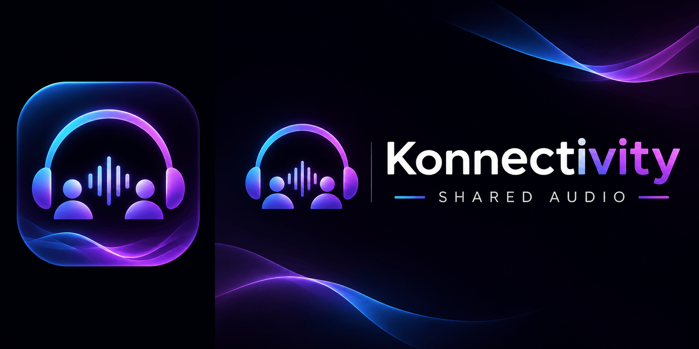

**Your friends. Your music. One shared room.**

Start a room, send one link, and everyone hears the same second of the same song. There's a shared queue anyone can add to, live chat, reactions, and an optional AI DJ that takes requests in plain English. It runs on a computer you already own, and your friends connect to it.

> **License:** This is a modified distribution of [Syncwave](https://github.com/SAKMZ/syncwave), under **PolyForm Noncommercial 1.0.0**. It is source-available, not OSI open source. The inherited noncommercial restriction cannot be removed by renaming the project. See [LICENSE](LICENSE), [NOTICE](NOTICE) and [release guidance](docs/RELEASING.md).

## Credits and thanks to Syncwave

**Konnectivity builds on [Syncwave](https://github.com/SAKMZ/syncwave). A heartfelt thank-you to the Syncwave team, its original creators, maintainers and every contributor for building and sharing the project that made this fork possible.**

The original Syncwave codebase, interface and self-hosted listening-room architecture form the foundation of Konnectivity. Credit for that original work belongs to the Syncwave team and contributors. Konnectivity extends their work with the changes described in [CHANGELOG.md](CHANGELOG.md) and [NOTICE](NOTICE).

Please visit the [original Syncwave repository](https://github.com/SAKMZ/syncwave), explore their work and give the team your support. You can also see the [upstream contributors](https://github.com/SAKMZ/syncwave/graphs/contributors).

The upstream copyright notice and **PolyForm Noncommercial 1.0.0** license are preserved in [LICENSE](LICENSE) and [NOTICE](NOTICE). This fork is maintained separately; no affiliation with or endorsement by the Syncwave team is implied.

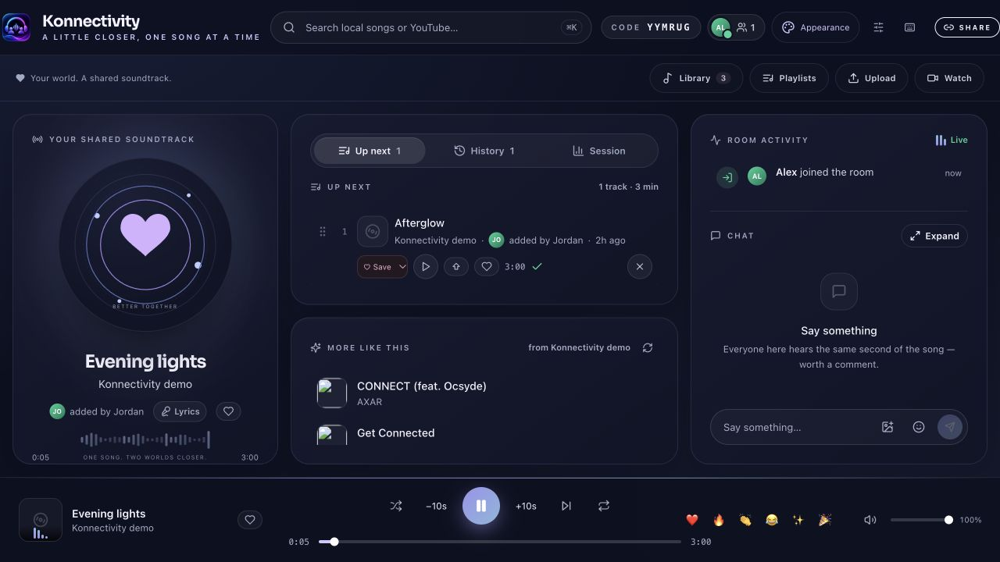

## Features

| Feature | What you can do |
| --- | --- |
| Listening rooms | Start a room and invite friends with one link to your self-hosted server. |
| Shared queue | Anyone in the room can add songs, reorder the queue and vote on tracks. |
| Synchronized controls | Play, pause, drag the song timeline, seek ±10 seconds and change shared volume. |
| Automatic synchronization | Calibrate each device’s clock, correct drift, coordinate buffering and recover after reconnecting. |
| Play now | Start a selected song immediately instead of adding it to the end of the queue. |
| YouTube search and video | Search for music and automatically open the selected YouTube video when playing an online result. |
| Link imports | Add supported YouTube and Spotify links; Spotify imports resolve to matching YouTube tracks. |
| Local music library | Upload MP3, FLAC, WAV and other supported formats to your server, with duplicate detection and persistent storage. |
| Saved playlists | Create and arrange playlists; opt in to saving references across new room codes and tunnel links. |
| Text and image chat | Chat while listening and share JPEG, PNG, GIF or WebP images. |
| Reactions and presence | React to songs and see who is listening in the room. |
| Optional AI DJ | Request music in plain English using your configured AI provider; disabled by default. |
| Themes and atmosphere | Moonlight, Rosewood and Candlelight themes, locally hosted Lottie artwork, optional ambient visualizers and reduced-motion support. |
| Mobile and PWA | Use a responsive interface with mobile volume controls, persistent search with All / Local library / YouTube filters and a clear button, and an installable web app. |
| Personal space | Opt in to reusing appearance, settings and photo/GIF backgrounds throughout this server. |
| One-click setup | Download/extract and start, or use the guided installer; runtime dependencies are set up automatically on supported platforms. |
| Server administration | Manage password-protected settings, optional downloader cookies and proxy configuration. |

Synchronization is automatic, but network outages, browser autoplay rules, YouTube ads and unreported headphone delay can affect how closely devices stay aligned.

No songs, cookies, API keys, passwords, existing rooms or user chat are included. You supply your own content and any optional credentials.

## One-click start

[**Download Konnectivity ZIP**](https://github.com/shivam-aggarwal-git/Konnectivity/archive/refs/heads/main.zip)

Extract the ZIP, then open the launcher for your computer. It installs the required packages and media tools, builds the app, and opens localhost automatically. No personal playlists, songs, images, cookies or settings are included.

| Computer | Start here |
| --- | --- |
| macOS | Double-click `Start-Konnectivity.command`. |
| Windows | Double-click `Start-Konnectivity.bat`. |
| Linux | Open a terminal in the extracted folder and run `bash start.sh --local`. |

Prefer one command, without downloading/extracting manually?

**macOS / Linux:**

```sh
curl -fsSL https://raw.githubusercontent.com/shivam-aggarwal-git/Konnectivity/main/install.sh | bash
```

**Windows PowerShell:**

```powershell
& ([scriptblock]::Create((Invoke-RestMethod https://raw.githubusercontent.com/shivam-aggarwal-git/Konnectivity/main/install.ps1)))
```

These commands install into your user folder’s `Konnectivity` directory and start locally. Re-running starts the existing installation without replacing its data. Node.js 22, npm dependencies, ffmpeg, Deno and a runnable downloader are set up automatically on supported desktop platforms. The standalone downloader avoids requiring a separate Python installation. Internet access is needed on first run; keep the terminal open while listening.

Open **http://localhost:3000/setup**, set an admin password, then create a room. `--local` avoids a public tunnel. It binds to loopback by default. For LAN access set `BIND_HOST=0.0.0.0` and restrict access with your firewall.

Already using port 3000? On macOS/Linux:

```sh
PORT=3001 npm run launch -- --local
```

For a public invitation, finish local admin setup, stop the local launcher, then run:

```sh
npm run launch
```

The launcher starts an HTTPS Cloudflare quick tunnel after setup. Guests need a complete invitation from **Share**, including its private token. Only the signed-in host can create rooms. Its address changes on restart. Use the room’s **Share** button for the current invitation. Keep the host running while listening.

## Development and checks

```sh
npm run dev                 # custom Next.js + Socket.IO development server
npm run typecheck
npm test                    # deterministic client clock/drift tests
npm run test:integration    # isolated shared controls, upload, playlist, media and sync tests
npm run build
npm start                   # production, after a build; no public tunnel
npm run check:release       # checks source tree for private/runtime content
```

Use the custom server commands above rather than `next start`: realtime rooms and upload/audio routes need `server.mjs`. Integration tests create temporary fixtures, require ffmpeg and bind loopback sockets; they do not use your personal library.

## Docker

```sh
cp .env.example .env
# Edit PUBLIC_URL and optional settings for your deployment.
docker compose up -d --build
docker compose logs -f
docker compose down
```

Complete `/setup` locally before exposing the server. Docker does not create a public tunnel. `data/` and `cache/` are persistent bind mounts. Never commit them.

## Screenshots

Screenshots use an isolated demo instance and generated demonstration audio, not a personal library.

| Desktop room | Mobile room |
| --- | --- |
|  | 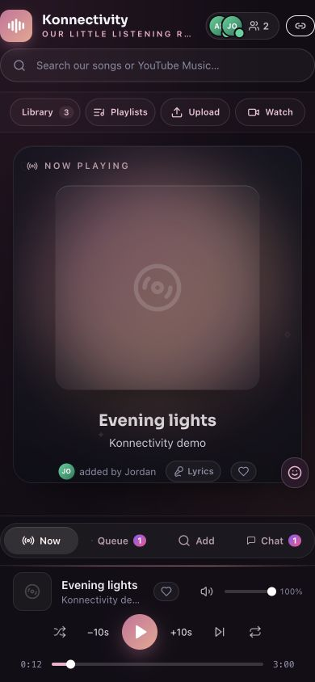 |

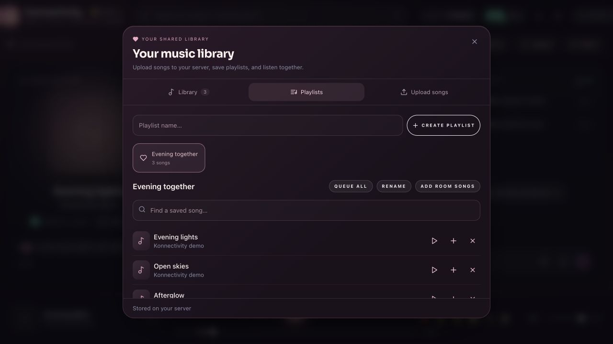

<details>
<summary>More screenshots: library, uploads, search, image chat and automatic sync</summary>

### Themes and atmosphere
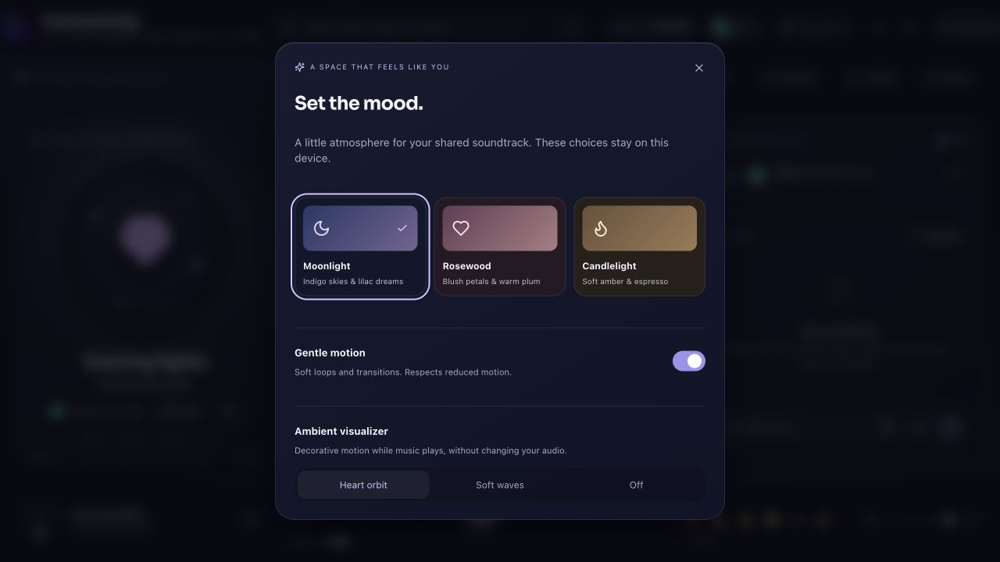

### Saved music library
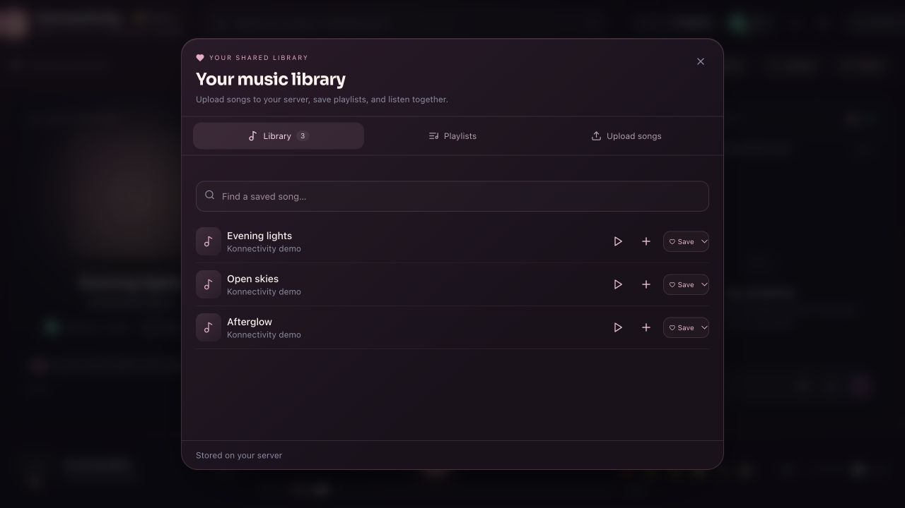

### Upload songs or folders
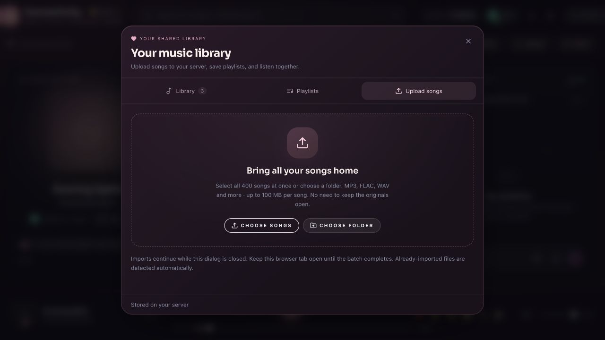

### Persistent search
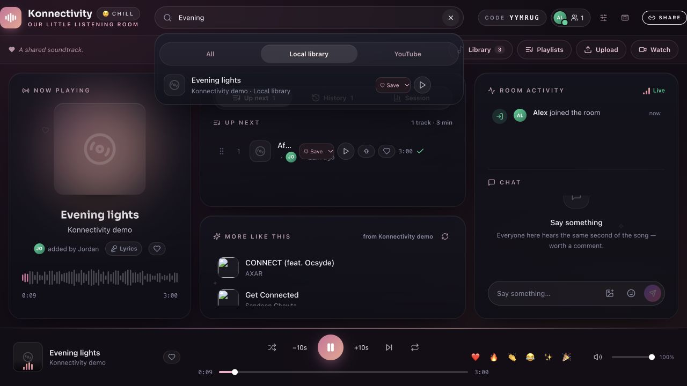

### Mobile image chat
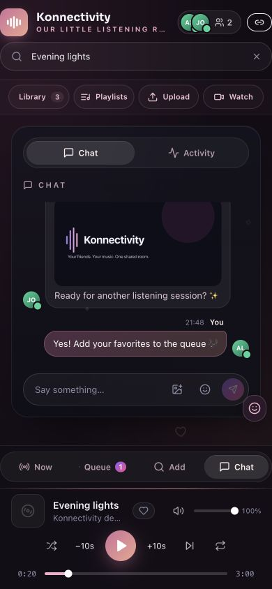

### Automatic synchronization
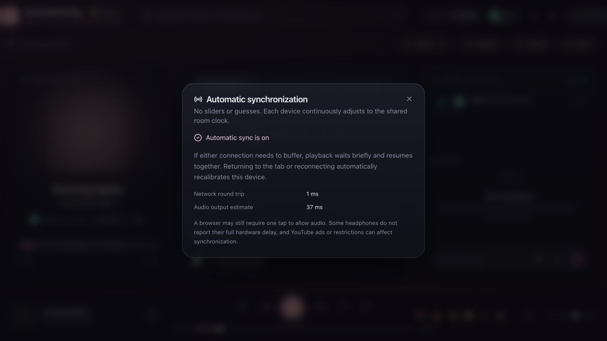

</details>

[Browse the complete screenshot gallery](docs/SCREENSHOTS.md)

## Documentation

- [Setup and commands](docs/SETUP.md)
- [Using rooms, uploads, playlists and chat](docs/USER_GUIDE.md)
- [Configuration](docs/CONFIGURATION.md)
- [Architecture and synchronization](docs/ARCHITECTURE.md)
- [Deployment, backup and upgrades](DEPLOY.md)
- [Troubleshooting](docs/TROUBLESHOOTING.md)
- [Release and licensing checklist](docs/RELEASING.md)
- [Contributing](CONTRIBUTING.md) · [Security](SECURITY.md) · [Code of conduct](CODE_OF_CONDUCT.md)

YouTube embeds use each listener’s own browser session. A server-side cookie does not transfer Premium to friends. Autoplay, ads, embedding restrictions and unreported headphone delay can limit synchronization. Use only content you have permission to upload or access.


## Legal

Konnectivity is a self-host tool. You run it and are responsible for how it is used where you live, including compliance with applicable laws, copyright permissions and the terms of any services you access.

Streaming audio from YouTube with unofficial tools may violate [YouTube’s Terms of Service](https://www.youtube.com/static?template=terms). Do not run a public or for-profit streaming service on top of it. A private invitation link is intended for listening with friends, not operating a public streaming platform. Only upload or access content you have permission to use and share.

Konnectivity and its upstream project, Syncwave, are not affiliated with, endorsed by or sponsored by Spotify or YouTube. Product names and trademarks belong to their respective owners.

Konnectivity retains Syncwave’s **PolyForm Noncommercial 1.0.0** license and required copyright notice. See [LICENSE](LICENSE) for the full terms and warranty disclaimer, and [NOTICE](NOTICE) for upstream attribution. The software license does not grant rights to third-party music or videos.

## Private rooms and atmosphere

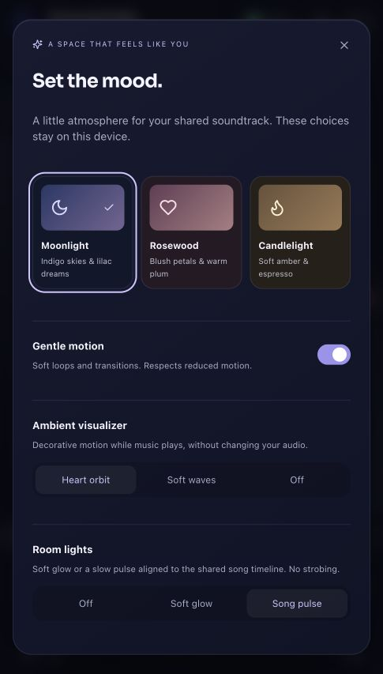

Search remembers recent queries on your device, with an **×** to remove each one, and offers song suggestions. Playback starts in **Audio** mode; **Switch to Video** uses the same YouTube song at its current position, without another link. Local uploads remain audio-only. Appearance includes soft glow and a slow song-timeline pulse, with reduced-motion support.

This is a private, trusted-friends instance: complete invitation links grant room access, and approved participants share the server music library. In approval rooms, waiting guests cannot receive chat or media. Old bare room codes do not grant access; send a fresh link from **Share** after upgrading. See [security](SECURITY.md) and [VPS deployment](DEPLOY.md).

### More room atmosphere

Choose Moonlight, Rosewood, Candlelight, Aurora, Afterglow or Ocean in Appearance. Color glow, a song-timeline pulse and floating lights brighten your room. The Home button and logo return to the player without interrupting the song.

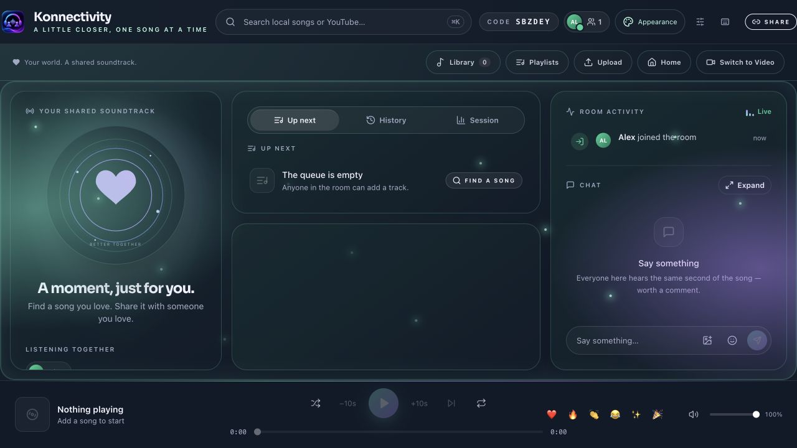

Appearance changes are synchronized within each room: either participant can change the theme, lights, visualizer and motion setting. New and reconnecting listeners receive the saved room appearance. Device accessibility preferences such as reduced motion still take priority.

## Shared photo backgrounds

Open **Appearance → Room background**. Choose **Upload a photo** to use a picture together (JPEG, PNG, WebP or GIF, up to 8 MB), or select **Song artwork** to follow the current song’s thumbnail automatically. Use **Darken background** to keep text readable. **Theme only** switches the image off; **Our photo** returns to the uploaded photo.

Either participant can change the background and darkness for the room. The choice is saved and synchronized to new and reconnecting listeners. Photos use private room-protected image storage on your own server, share the configured image-storage quota, and are not automatically posted to chat. Switching to Theme only does not delete the stored photo. If a local song has no artwork, the theme remains visible.

### Full player and cover recovery

Click the Konnectivity logo/tagline to open the full player, then the down-chevron to keep listening in the bottom bar. Failed cover URLs fall back to an authenticated YouTube thumbnail or the animated placeholder.

### iPhone media and player controls

HEIC/HEIF uploads convert privately to JPEG, while GIF backgrounds retain animation. The visible bottom-bar chevron and mobile swipe gestures expand/collapse the player. A device-local clock appears in the header/player. Lyrics use Hindi/English scripts only when a suitable version is available; no automatic translation is claimed.

The full player shares your selected GIF/photo background and mood lights. Incoming chat banners show unread counts and open chat directly; mobile room controls stay aligned in one row.

You can import a YouTube playlist from Playlists (up to 100 available tracks per import), save it under its original or a custom name, then rename or delete it. The full player also has a shared Hide artwork control for an unobstructed GIF/light background. The clock is explicitly labelled Local time and includes AM/PM and the date.

### Lyrics and host controls

Lyrics now come through [Lyrica](https://github.com/Wilooper/Lyrica). Thank you to Wilooper and the Lyrica contributors. Konnectivity explicitly excludes its LRCLIB provider; configure `LYRICA_URL` to use your own Lyrica service. Availability and timing depend on upstream providers. Only public song metadata is sent, never YouTube cookies.

New listeners require approval by default, with a popup showing their name and **Let in / Decline** actions. Hosts can change this under **People**, mute chat, and remove listeners with confirmation. Phone layouts use keyboard-aware sheets and larger touch targets. See [configuration](docs/CONFIGURATION.md#lyrics-and-room-approval) for temporary removal limits and migration details.

### Playlists and backgrounds on mobile

- Select several saved playlists and queue them together, up to 2,000 songs per batch.
- Expand a playlist or queue, drag with edge scrolling, or move any song directly to a numbered position.
- Save shows confirmed saved state and marks playlists already containing the song.
- Frame photos and animated GIFs with drag, zoom, Fill/Fit and sharpness controls. Framing syncs across the room.
- Hide the main panels to enjoy your background while keeping playback controls at hand.

See the [user guide](docs/USER_GUIDE.md#queue-several-playlists-and-arrange-long-lists) for instructions and screenshots.
