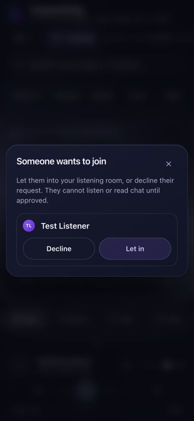
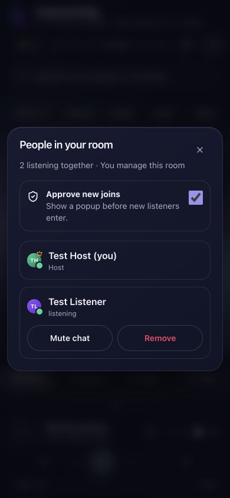
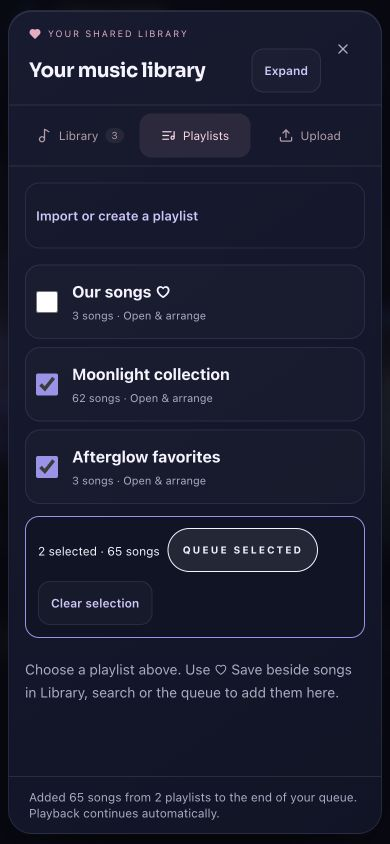
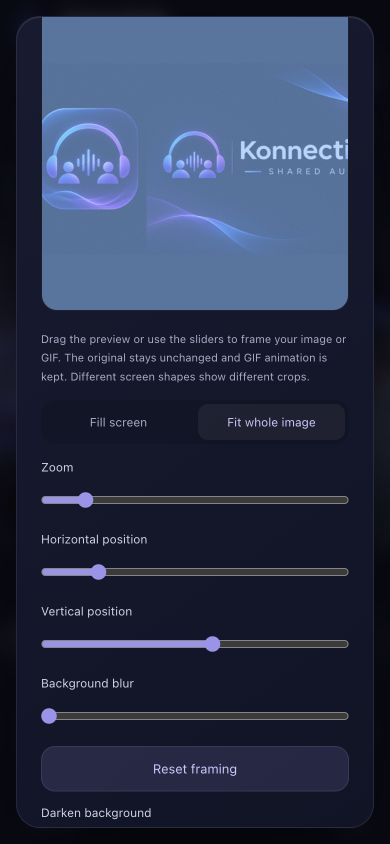
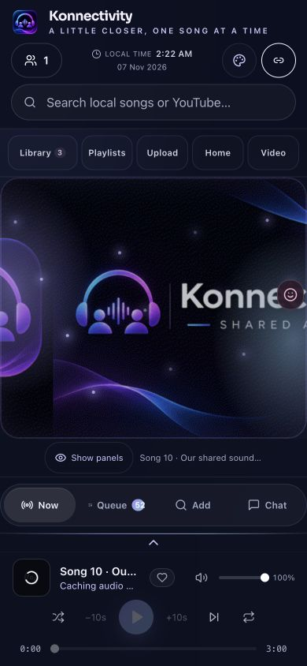
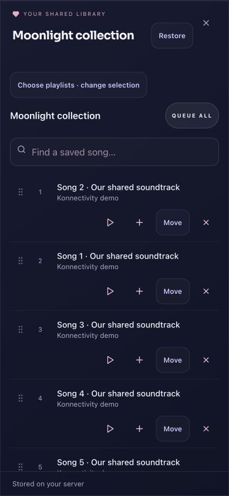
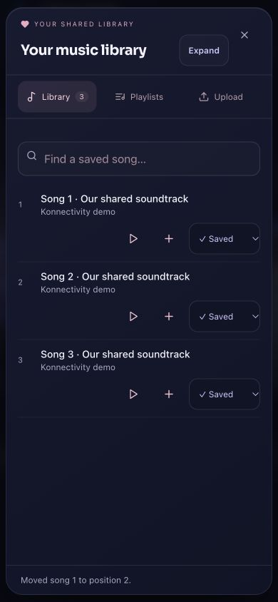
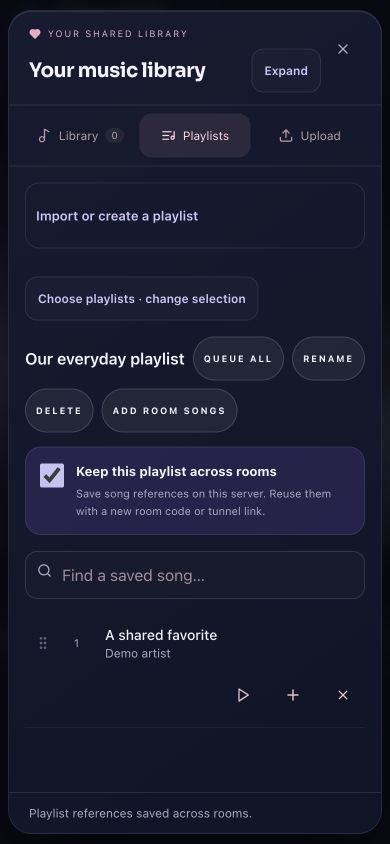
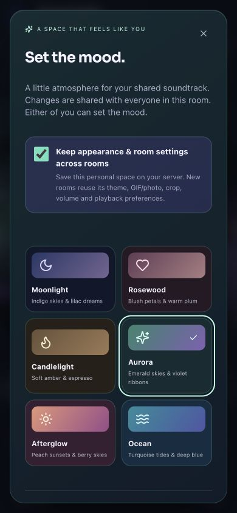

# User guide

## Start and share a room

Set the server admin password on `/setup`, then use the home page to create a room. Choose a nickname and share the room link. Invite-only rooms use admission controls; retain the creator’s browser storage to keep host ownership. `?host=1` alone does not grant ownership without the saved owner token.

All admitted listeners can use shared playback controls. Play/pause, timeline dragging, ±10 seconds and volume update the room. Actual loudness can differ between speakers. Phones may require a tap to permit audio, especially after changing media type.

## Search, queue and video

Use the always-visible search field or magnifier. Choose **All**, **Local library** or **YouTube** to filter the source. Local library searches uploaded songs without contacting YouTube. Use the **× Clear search** button to delete the query, including while results are loading. Click a search result or **Play now** to start it immediately; **+** adds it to the queue. Playback starts in audio mode. Switch to Video to open the corresponding YouTube video at the shared position. A selected upload may show album artwork rather than an official music video. Local library results stay audio.

You can also paste a direct YouTube link into search. Spotify links are resolved to matching YouTube tracks; this is not Spotify account playback. YouTube can reject an embed or downloader request. Server cookies do not sign another person into Premium.

## Upload your library

Open **Library → Upload**, select multiple supported audio files and keep the tab open during import. Files are stored on the host server, not on each listener’s device. MP3, FLAC, WAV and other ffmpeg-readable allowed formats are accepted, up to **100 MB per file**. Duplicate content is skipped. Failed files can be selected again.

Uploaded songs are persistent and separate from temporary online audio cache. Everyone in a room can see the shared server library. Only upload content you may share with the listeners.

## Saved playlists

Open **Library → Playlists**, enter a name and click **Create playlist**. Use **♡ Save** beside a song in search, library or the queue to add it to an existing playlist. Rename a selected playlist from its controls. Saved playlists can be reused to queue songs on later visits. They live on the server and need a data backup to survive disk loss.

## Chat and reactions

Use **Expand** in the Chat header for a larger conversation view. Scroll the message history independently; the message box stays at the bottom. New messages follow automatically when you are near the bottom, while scrolling up lets you read older messages without jumping. Use **Collapse** or Escape to return to the room.

Use Chat to send text or attach JPEG, PNG, GIF or WebP images (up to **8 MB**). Images are stored on the server and scoped to the room’s upload token; do not use chat as a private encrypted messenger. Reactions appear beside the player without covering its main controls.

## Automatic sync

No manual latency input is required. Devices calibrate against the server, correct drift and recalibrate on reconnect or tab return. The Sound settings dialog shows automatic status and measured latency where available. Brief seeking and foreground recovery have a grace period to avoid pause loops. A background listener cannot hold the room while its browser is suspended; it catches up when it returns. If a foreground listener continues buffering, the room waits briefly and schedules a common restart. After about 20 seconds a blocked device no longer holds everyone; it catches up after recovery. A manual pause remains paused.

The app cannot remove network outages, YouTube ads or unreported Bluetooth latency. Keep the tab active when possible. See [troubleshooting](TROUBLESHOOTING.md).

## Themes and atmosphere

Open **Appearance** (palette icon on a phone) to switch between **Moonlight**, **Rosewood** and **Candlelight**. Moonlight is the default. Choices are saved on your device across rooms. Each listener can choose their own look.

Choose **Heart orbit**, **Soft waves** or **Off** for the ambient visualizer. These are decorative animations, not an audio spectrum analyzer. They do not process or change playback. **Gentle motion** disables continuous decorative movement, and system reduced-motion preferences are respected. The local Lottie artwork pauses when music is paused or the tab is hidden.

## Private invitations and search

Use **Share** to copy the full invitation. A room code alone does not unlock a private group. Visitors can create groups from the home page after the server is set up. Enable approval to admit each guest explicitly. Each group has its own music library.

Open Search to see suggestions and recent queries. Use the small **×** beside a recent query to remove it from this device. The larger **×** clears the current input. Filter with **Local library**, **YouTube**, or **All**.

## Audio, video and room lights

Rooms start in Audio mode. **Switch to Video** uses the current YouTube song and position; **Switch to Audio** returns to audio. A local file has no automatic YouTube video. In Appearance, choose **Room lights → Off / Soft glow / Song pulse**. Song pulse follows the shared playback timeline rather than claiming beat detection. Gentle motion and reduced-motion preferences are respected. Popups dismiss on outside click or Escape.

## Vivid atmosphere and Home

The **Home** button and the **Konnectivity** logo/tagline return to Now Playing, close lyrics, and restore Up Next without restarting the song or leaving the room.

Appearance now offers six themes: Moonlight, Rosewood, Candlelight, Aurora, Afterglow, and Ocean. **Color glow** gives the room visible washes of color; **Song pulse** changes their intensity on the shared playback timeline while music plays. Floating fireflies add ambient motion. Turn Room lights off or disable Gentle motion when you prefer a quieter view. These effects are decorative, not beat detection, and do not process your audio.

Appearance changes are synchronized within each room: either participant can change the theme, lights, visualizer and motion setting. New and reconnecting listeners receive the saved room appearance. Device accessibility preferences such as reduced motion still take priority.

## Shared photo backgrounds

Open **Appearance → Room background**. Choose **Upload a photo** to use a picture together (JPEG, PNG, WebP or GIF, up to 8 MB), or select **Song artwork** to follow the current song’s thumbnail automatically. Use **Darken background** to keep text readable. **Theme only** switches the image off; **Our photo** returns to the uploaded photo.

Either participant can change the background and darkness for the room. The choice is saved and synchronized to new and reconnecting listeners. Photos use private room-protected image storage on your own server, share the configured image-storage quota, and are not automatically posted to chat. Switching to Theme only does not delete the stored photo. If a local song has no artwork, the theme remains visible.

## Expand and collapse the player

Click the **Konnectivity logo or tagline** (or Home) to open the full player. Use the **down-chevron** at the top left to collapse back to the room and keep music playing in the bottom bar. Opening and closing this view never replaces the audio elements.

If the high-resolution cover or thumbnail fails, the player tries a fixed YouTube thumbnail through the authenticated server. If no image is available, the animated placeholder replaces it. Local songs without artwork use the placeholder. The thumbnail endpoint only contacts YouTube’s fixed image host, accepts valid video IDs and does not forward your YouTube cookies.

## iPhone photos, GIFs and mobile player gestures

- **HEIC/HEIF:** upload directly in chat or Room background. The server converts the primary still image to a browser-friendly JPEG. Uploads remain limited to 8 MB; exceptionally large or unsupported photos show a conversion error. Conversion runs separately from the playback process.
- **Animated GIFs:** choose Upload photo or GIF in Appearance. GIF bytes are preserved so animation stays intact. Both listeners share the selected background.
- **Mobile player:** tap the visible chevron above the bottom media controls, or swipe up on the bottom bar to expand. Swipe down on the artwork/header, or tap either down-chevron, to collapse. Timeline and volume sliders retain their normal gestures.
- **Clock:** the header and full player show the current time in your device’s local timezone.
- **Lyrics:** display is restricted to Latin/English and Hindi/Devanagari scripts. The app looks for a supported alternative rather than displaying Urdu or another script. It does not automatically translate lyrics; when no suitable version exists, it shows an availability message.

HEIC conversion uses [heic-decode](https://github.com/catdad-experiments/heic-decode) and the existing Sharp image library. The local validation used the [libheif public example](https://github.com/strukturag/libheif/tree/master/examples), not a personal photo; that fixture is not included in this source release.

## Chat notifications and player atmosphere

Incoming messages show an in-app notification with a numeric unread count and the latest sender when you are away from chat, including while the full player is open. Tap the banner to open chat and clear the count. Your own messages do not count as unread. Dismissing a banner hides it without marking the conversation read; another incoming message shows it again.

The expanded player now uses the same shared photo/GIF background, song artwork, theme colors and room lights as the room view. Choose a GIF in Appearance to animate the player background, and choose Color glow or Song pulse for the lights. Gentle motion and reduced-motion preferences still govern the decorative light effects. GIF images retain their own animation.

On phones, the Library, Playlists, Upload, Home and Video/Audio buttons use one aligned row. The shorter Video/Audio labels keep the mode control from wrapping to three lines.

## Import a YouTube playlist

Open **Playlists**, paste a YouTube or YouTube Music playlist link into **Import YouTube playlist**, then press **Import playlist**. A watch link with a `list` parameter works too. Up to 100 available songs are saved as a new shared playlist; playback and the queue stay unchanged. Larger lists report the import limit. Use the playlist’s Rename or Delete controls afterward; deleting a playlist keeps uploaded library files. Public/unlisted lists work, while private lists require access through the server’s configured account cookies. Auto-generated endless mixes are not imported.

**Hide artwork** is available in the full player and as **Appearance → Show artwork**. It is shared and saved with the room, leaving your GIF/photo background and mood lights visible. The labelled Local time clock includes AM/PM and the date, using each device’s local timezone.

## Approve joins and manage people

New rooms require host approval. Incoming listeners trigger a named popup: choose **Let in** or **Decline**. Closing the popup keeps the request waiting; reopen it from the waiting button. Use **People → Approve new joins** to control admission. Hosts can mute another listener’s chat or use **Remove → Remove now**. Removal disconnects them and temporarily blocks rejoining from their IP for 30 minutes; people sharing that IP may be affected, while hosts can reconnect.

Lyrics use Lyrica. They follow the shared song position when timed lyrics are available. Only Latin and Devanagari lyric lines are displayed; unsupported translations or credits are omitted. YouTube credentials are never forwarded to the lyrics service.

## Queue several playlists and arrange long lists

In **Playlists**, check the collections you want, then press **Queue selected**. Songs are appended in selection order, with each playlist’s saved order preserved. Existing playback continues. You can queue another selection later; duplicate songs across playlists remain separate queue entries. A batch may contain up to 2,000 songs. **Queue all** appends only the open playlist.

Open a playlist and press **Expand** for a full-screen editor. Playlist choices collapse when you open one; **Choose playlists** brings them back. All playlist songs are available, with search to jump straight to song 56. **Move → New position → 6** moves it directly to sixth place, even while searching. Drag handles work with touch or mouse and scroll at the list edges; arrow keys move one row. Saved playlist changes sync and persist. The queue also has **Expand queue**, drag handles and **Move**; queue changes do not change the saved playlist.

**Save** changes to **✓ Saved** when the server’s playlist update confirms a song is saved. Already containing playlists are marked and disabled in the picker. Creating a playlist shows a saved confirmation or a timeout/error instead of waiting indefinitely.

## Frame a photo or animated GIF

Open **Appearance**, upload a background, then drag its preview to choose the focal point. Use **Fill screen / Fit whole image**, **Zoom**, horizontal/vertical position and optional blur. **Reset framing** restores the centered, sharp view. Framing changes are shared and saved; the original file is unchanged, so GIFs stay animated. Screen aspect ratios produce different crops; use Fit whole image when seeing the entire photo matters.

**Hide panels · show background** sits above the mobile Now/Queue/Add/Chat row and hides the main cards while keeping playback controls available. **Show panels** restores them; selecting a tab also restores that panel. The expanded player has **Hide details** as well as the separate shared artwork toggle. Panel visibility is local to your device, while framing, themes, artwork visibility and lights remain shared.

## Keep your personal space when the room code changes

Open a playlist and check **Keep this playlist across rooms**. This saves the name, song order and references on your server. No extra audio is downloaded just to save it. The playlist appears in other/new rooms on this instance and shared edits are retained. Leave it unchecked for a room-only playlist. Unchecking stops future inheritance and keeps existing copies; deleting a persistent playlist deletes its references across rooms.

In **Appearance**, the host can enable **Keep appearance & room settings across rooms**. Theme, animation preferences, lights, uploaded background photo/GIF, crop, volume, shuffle/repeat and join-approval defaults are then reused. Either listener can continue changing the shared appearance. The new-room approval checkbox defaults to the saved preference; an explicit change there overrides it.

Keep the server’s `data/` directory when updating or moving the app. A rotating Cloudflare hostname does not reset the server data. A new hostname may require the host to sign in again and send a fresh invitation; it does not silently copy browser login cookies between websites. Admin secrets stay server-side. Queue position, chat history, participants and host access are not copied into a new room.

### Host permissions and platform settings

Settings → Listener permissions lets the host allow or restrict all current and future listeners together. Controls include text, photos, chat video, location, comments, reactions, player messages, voting, polls, plans, uploads, queue, playlists, shared playback, appearance and calls. The host is exempt. Changes are enforced by the server, saved with the room, and sent to connected listeners. Disabling calls disconnects listener call sessions. Disabling synchronization removes listener clock correction and buffering barriers; shared track changes still apply.

Platform administration in Settings requires a separate authenticated platform-admin session. It includes YouTube Netscape cookie import, proxy access, AI provider settings and TURN/Cloudflare relay configuration. No YouTube password is requested. Saved relay secrets remain in the server data directory; only configured/not-configured indicators return to the browser. Rejoin calls after changing relay configuration.

### Mobile chat and video

Chat opens a full-height, keyboard-aware panel with a full-width message field, attachment actions and a close button. Video has replay, fullscreen, hide/show controls, picture-in-picture and an in-app floating overlay. System PiP depends on browser support; unsupported sources use the floating overlay inside Konnectivity. MP4/H.264/AAC offers broad mobile compatibility. New tracks start in Audio mode unless Video is selected explicitly.

## Room guide, camera preview, and multiple rooms

The first time a listener joins, the room guide walks them through search, playback, playlists, chat, calls, and invitations. Use **Next**, **Back**, or **Skip guide**. To replay it, open **Settings → Room guide**.

Your front-camera preview behaves like a mirror by default. Toggle **Mirror my camera** in the call controls to change your preview. Other listeners receive the original camera feed, and screen sharing and known rear cameras keep their original orientation.

Open **SuperAdmin Console → Listening rooms** to manage rooms or create a group. Each group has its own admin, code, invitation, queue, chat, call, and participant list. Legacy personal rooms may share settings through Personal Space.

## Private groups and room admins

Sign in as superadmin and use **Admin → Listening rooms** to create a group for someone else. Open **Manage → Create admin setup link**, then send that single-use link privately to the selected room admin. When they join, the browser receives a separate room credential. The setup link then stops working, and the dashboard cannot issue a replacement for a claimed room.

The group admin uploads their own YouTube cookies under **Settings → Room YouTube cookies**, manages listener permissions, and sends the regular **Share** invitation to members. Leave approval enabled if the group should admit only people the admin recognizes. Group cookies, uploads, queue, playlists, appearance, and access stay scoped to the room. Cookies apply to server downloads and link imports. YouTube embeds use each viewer’s browser session.

The room admin should save **Show private admin recovery link** from room settings. When the Cloudflare quick tunnel changes, replace the hostname in that link with the current hostname and keep the rest intact. The same room code, credential and persisted settings work. The room admin can give listeners a fresh invitation for the same room. Listener approvals are session-based, so the admin may need to approve them again.

The superadmin dashboard shows operational room metadata and can delete a group, which ends its call and playback, invalidates its links, and removes its cookie. It does not grant membership or access to group settings or media. The server operator still controls the Mac and its files. Existing personal rooms retain their earlier behavior. Group chat history is session-based.

## Create and remove group rooms

Creating a group makes you its room admin. Listeners can create a group from the **Groups** page. In the superadmin dashboard, select **Create for someone else and assign their admin later** if you want a single-use setup link for another person.

The superadmin can delete individual rooms from **Manage**, or use **Delete all rooms**. Bulk deletion includes every room on the server, even rooms hidden by search. It requires typing `DELETE ALL` and reconfirming if the room list changed.

To remove specific rooms, select their checkboxes and choose **Delete selected**. The confirmation lists the selected rooms by name and code. Selections stay checked across searches and pages.

### Instance branding

In **SuperAdmin Console → Branding**, upload a logo for the home and room headers and a favicon for browser tabs and the installable app. Use PNG, JPEG or WebP images up to 4 MB. The server saves each image independently, and **Restore default** resets only that image. Refresh an open room to see the new branding.

Proxy Pool and TURN relay configuration are available in the SuperAdmin Console. Group admins can use the configured call relay as participants in their rooms.

### Create or find a group

From the home page, select **Open Konnectivity** to open **Groups**, then choose **Create a group**, **Find a random group**, or join from an invitation. Group creators are the group admins. Upload a Netscape-format YouTube `cookies.txt` in the setup prompt or in **Settings → Room YouTube cookies**. New groups need the upload for YouTube playback and link imports. Chat, calls, and local media are available during setup. The upload is stored separately for each group and only that group's admin can replace or remove it.

Groups are private by default. Enable random matching on creation or in room **Settings** to appear in the matching pool while a group admin is online. YouTube setup is separate from admission. Every match is a join request the group admin must approve. TURN remains a server setting in the **SuperAdmin Console**.
